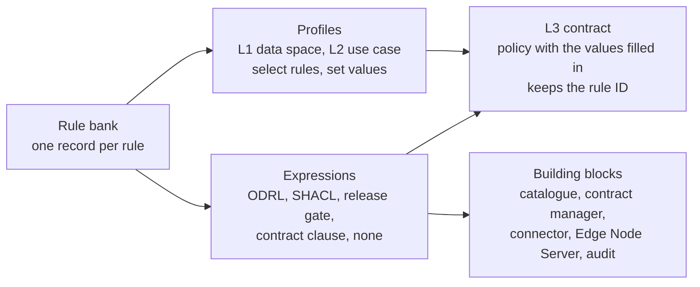

# Prometheus-X rule bank

Machine-readable rules for the Prometheus-X data spaces.

Every rule of the common rulebook is stored here as a record with the same fields, whatever its level. Each record says how the rule is checked, and each building block reads the part it understands: the catalogue reads validation shapes, the contract manager and the connector read ODRL, the Edge Node Server reads release gates, and audit reads the list of evidence.

> **Status: first R&D version.** Level 0 only. All rules are candidates and parameter values are illustrative. The record follows the fields of the DSSC rule record, with a few additions for parameters and expressions.

## Level 0 rules

Level 0 holds the rules common to all data spaces. Some are fixed, others are generic patterns whose parameters are set by each data space (L1), use case type (L2) or contract (L3).

<!-- status:start -->
| Rule | Title | Class | Expression | Status |
| --- | --- | --- | --- | --- |
| [`ptx:rule/L0-AI-LITERACY`](rules/L0/L0-AI-LITERACY.json) | AI literacy of staff | E1 | none | checked by people |
| [`ptx:rule/L0-CONTRACTED-EXCHANGE`](rules/L0/L0-CONTRACTED-EXCHANGE.json) | No exchange without a contract | E2 | not-yet-specified | remains to do |
| [`ptx:rule/L0-PURPOSE-LIMITATION`](rules/L0/L0-PURPOSE-LIMITATION.json) | Use limited to the contracted purposes | E2 | odrl-template | expressed |
| [`ptx:rule/L0-RELEASE-THRESHOLD`](rules/L0/L0-RELEASE-THRESHOLD.json) | Minimum group size for aggregated results | E3 | release-gate | expressed |
| [`ptx:rule/L0-RETENTION`](rules/L0/L0-RETENTION.json) | Retention and deletion | E2 | odrl-template | expressed |
<!-- status:end -->

Rules use a `ptx:rule/` identifier. When a rule is taken up in the register of the DSSC Rulebook Accelerator, it keeps the DSSC identifier (`dssc:` prefix).

"Expressed" means the artifact exists in this repository. It does not mean a building block enforces it today: enforcement is tracked per data space in validation records, which come next.

## How it works



**One record per rule.** A record holds the statement, who it binds, its level, its parameters, how it is checked (`control`), what proves it (`evidence`) and one or more `expressions`. The fields are described in [docs/rule-record.md](docs/rule-record.md).

**Expressions.** A record points to the artifacts that check it. A building block only reads the expression types it knows.

| Type | Artifact | Read by |
| --- | --- | --- |
| `odrl-template` | ODRL policy template, in the PTX catalog registry format | Contract manager, connector |
| `credential-requirement` | ODRL with the Gaia-X ODRL-VC profile | Onboarding, contract manager |
| `shacl-shape` | SHACL shape | Catalogue, contract manager |
| `contract-clause` | Block of the PTX contract model | Contract manager |
| `release-gate`, `monitoring` | JSON check on the parameters of the rule | Edge Node Server, Value Chain Tracker |
| `none` | No artifact: `control` says who checks, `evidence` says on what | Audit, governance authority |
| `not-yet-specified` | To be written | |

**Parameters can only get stricter.** Each parameter says which level sets it and which direction is stricter. A data space or use case can raise a minimum group size, never lower it. For `ptx:rule/L0-RELEASE-THRESHOLD`, DS4Skills could set 10 and xAPI for Research 20; a contract asking for 15 would be rejected.

**Enforcement classes.**

| Class | Meaning |
| --- | --- |
| E0 | Declarative principle |
| E1 | Checked by contract or audit |
| E2 | Enforced or monitored by connector, catalogue, policy engine or logs |
| E3 | Requires a protected compute environment, such as compute-to-data on the Edge Node Server |

**The contract keeps the rule ID.** Every artifact carries `dsif:sourceRule`. When a policy is generated from a template, the link stays in the contract, so the connector and the Edge Node Server know which rule they enforce, and another data space can read the same rule.

## Repository layout

```
context/rulebank.jsonld          JSON-LD context of the records
schema/rule-record.schema.json   JSON Schema of a rule record
rules/L0/                        Level 0 rule records, one file per rule
expressions/odrl/                ODRL templates
expressions/release-gates/       Release gates for the Edge Node Server
scripts/rulebank.py              Validation and status table
docs/rule-record.md              Field reference
```

The artifacts in `expressions/` are the reference version. Each one is loaded where its building block expects it (the ODRL templates in the PTX catalog registry, for example), and the `ref` field of the expression gives that identifier.

## Validate

```
pip install -r requirements.txt
python scripts/rulebank.py validate
python scripts/rulebank.py status --write
```

`validate` checks every record against the schema, that file names and folders match identifiers and levels, that each artifact exists, parses and points back to its rule, and that the status table above is up to date. It runs on every push and pull request.

## Open points

- **Namespace.** Rules are published under `ptx:` for now. Whether the vocabulary and the bank move under DSIF is still open. The `w3id.org` IRIs are not registered yet.
- **Profile terms.** `dsif:sourceRule` and `dsif:enforcementClass` come from the DSIF ODRL profile plan and are not published yet.
- **Release gate format.** To align with the Edge Node Server: gate identifiers, check expression format, what the gate log contains.
- **Checks built into the connector.** `L0-CONTRACTED-EXCHANGE` is enforced by the PTX connector by design. We still have to decide how a record points to a built-in check.
- **More Level 0 rules.** Other rules are being placed with the DSSC Rulebook Accelerator. They enter the bank once their level is agreed.

## Contributing

Every data space has to translate its rules for machines, and this work can be shared. We welcome contributions on the rule format, on the governance of the rule bank and on the translation of other rules. Open an issue or a pull request.

Built by the Prometheus-X community with Visions, aligned with the DSSC Rulebook Accelerator and the Data Space Interoperability Framework (DSIF).

## License

[MIT](LICENSE)
